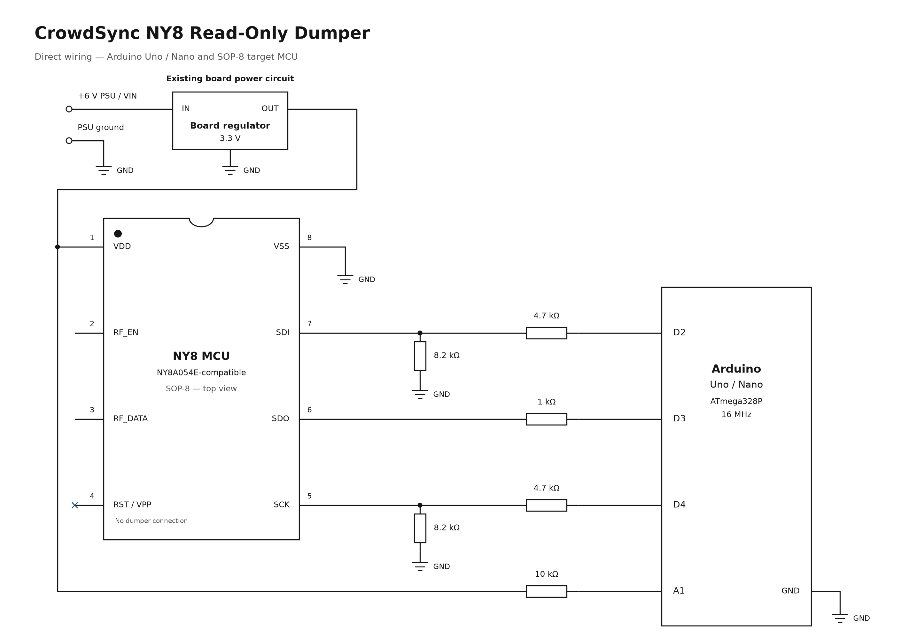

# Nyquest NY8 Firmware Dumper

This Arduino program reads the program memory of an NY8-family MCU using its programming interface. The CrowdSync board is powered through its normal supply, while the Arduino watches the regulated MCU rail and sends the programming handshake shortly after power-on.

The program sends read commands only. It does not drive target power, apply Vpp, or send erase, program or configuration-write commands.

## Hardware Setup

Use a classic **5 V, 16 MHz ATmega328P Arduino Uno or Nano**. Power the Arduino by USB and the CrowdSync board through its normal input; the bench setup used a 6 V supply feeding the board's regulator.

| MCU Pin | Programming Signal | Arduino Connection |
|---:|---|---|
| 1 | VDD | A1 through a 10 kΩ series resistor; the board regulator continues to power this rail. |
| 5 | SCK | D4 through the SCK voltage divider. |
| 6 | SDO | D3 input through a 1 kΩ series resistor. |
| 7 | SDI | D2 through the SDI voltage divider. |
| 8 | Ground | Common Arduino / board / PSU ground. |

Leave MCU pin 4 disconnected. Do not connect Arduino power outputs to the MCU supply. Pins 5-7 also connect to the LEDs, so use the resistors shown rather than connecting 5 V outputs directly to those pins.

For each D2/D4 divider, connect 4.7 kΩ from the Arduino output to the MCU-side signal node, and 8.2 kΩ from that node to ground. This produces approximately 3.18 V from a 5 V output. Other useful pairs are 470 Ω/820 Ω or 1 kΩ/1.8 kΩ. A 1 kΩ series resistor with two 1 kΩ resistors in series to ground produces approximately 3.33 V.



The four Arduino signal connections are drawn as continuous wires. A1 connects through 10 kΩ to MCU pin 1 and the board regulator output. All GND symbols share a common connection. The MCU is shown from above, with four pins on each side and a dot at pin 1. The regulator and MCU are existing wristband components; the resistors are added externally. Other receiver and LED circuitry is omitted.

Power the Arduino before the target. Keep it powered while the wristband supply is on, and turn off the target before changing the connections.

## Reading Firmware

1. Upload [CrowdSync_Arduino_NY8_Dumper.ino](CrowdSync_Arduino_NY8_Dumper.ino).
2. Open Serial Monitor at **115200 baud**.
3. Select `2` for the NY8A054E-style profile: a four-byte read command and 2048 program words.
4. Turn the wristband supply off. Wait for the `ARMED` message, then turn the supply on.
5. Save the word lines between `BEGIN_DUMP` and `END_DUMP` to a text file. Keep the diagnostic output separately.
6. Repeat from a full power-off state and compare the dumped words and reported `FNV1A32` value.

The A1 input detects MCU VDD rising. The Arduino leaves its programming signals high-impedance until the rail reaches approximately 2.2 V. It then starts the handshake no earlier than 500 µs after the detected rise and reports the actual timing offset.

After the handshake, the program checks whether SDO remains LOW. This is an indication that programming mode was entered, rather than an explicit acknowledgement from the chip. A complete transfer can still contain incorrect data, so repeated matching reads are useful when checking the result. Blank or inconsistent output can also indicate incorrect wiring, timing or loading from the attached LED circuit.

The `1` profile reads 1024 words with a three-byte read command and is retained for other NY8-family investigations. The CrowdSync firmware examined for this project matches the 2048-word profile.

## Output Format

Each program word is 14 bits and is printed as four hexadecimal digits. The output is a whitespace-separated list, not Intel HEX. The 2048-word profile produces 4096 bytes when stored as big-endian two-byte words.

The text can be converted with:

```sh
xxd -r -p crowdsync_firmware.hex > crowdsync_firmware.bin
```

Diagnostic messages must be removed before running this conversion. The reported transfer count and content statistics describe what was read; matching a second independent read gives a stronger check than converting the same text into another file format.
