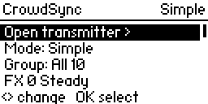
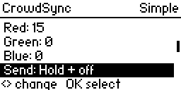
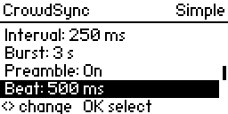
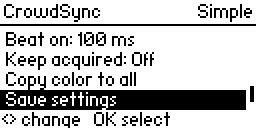
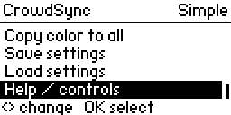
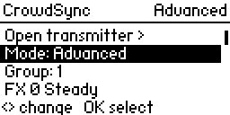
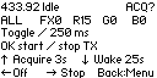

# CrowdSync for Flipper Zero

A standalone controller for CrowdSync wristbands using the Flipper's built-in Sub-GHz radio at **433.92 MHz**. It sends the protocol described in [OPERATION.md](../OPERATION.md).

      

## Install

1. Download [crowdsync.fap](crowdsync.fap).
2. Open the Flipper's SD card in qFlipper's file manager and copy the file to `apps/Sub-GHz/`.
3. On the Flipper, open **Apps → Sub-GHz → CrowdSync**.

The included build targets **official firmware 1.5.1, SDK API 88.2**. If your firmware reports an incompatible app, rebuild against its SDK using the instructions below. The app follows the Flipper's configured transmission restrictions.

## Choose Colors & Effects

On first launch, the app opens in **Simple** mode with steady red selected. Later launches restore saved settings. Use Up/Down to select a row and Left/Right to change its value. OK opens an action or advances a setting. Values wrap: Left from 0 selects 15, and Right from 15 selects 0.

| Setting | Purpose |
|---|---|
| Mode | Simple sends the same effect and RGB values to all ten groups. Advanced lets you edit each group separately. |
| Group | Selects group 1–10 for editing in Advanced mode. Simple mode always shows All 10. |
| FX | Selects effect 0–15. See the [effect descriptions](../OPERATION.md#led-effects). |
| Red / Green / Blue | Each channel has levels 0–15. |
| Keep acquired | Repeats black commands on the transmitter screen while no foreground command is running. Default: Off. |
| Copy color to all | Copies the currently selected effect and RGB values into all ten Advanced group assignments. |

Simple and Advanced keep separate color profiles, so switching modes does not erase your group assignments. Advanced defaults to group 1 selected, with steady red in all ten groups. Existing saved settings take precedence over these defaults.

**Every packet contains all ten group assignments.** The Group row chooses which assignment you edit; the other nine assignments are still transmitted. Unused groups should be set to the colors you want them to display, usually black.

Color, effect and timing edits do not transmit. Select **Open transmitter** when ready. Keep acquired only transmits on the transmitter screen; editing settings never starts RF transmission.

## Transmitter Controls

| Button | Action |
|---|---|
| OK | Starts/stops the selected send mode. In Hold + off mode, press and hold instead. |
| ↑ Up | Sends steady black to all ten groups for 3 seconds to acquire nearby wristbands without lighting them. |
| ↓ Down | Sends steady black to all ten groups for 25 seconds to wake wristbands from power saving without lighting them. |
| ← Left | Sends black to all ten groups three times, at 100 ms spacing (a 300 ms burst). |
| → Right | Stops the foreground command. Keep acquired continues when enabled; otherwise RF transmission stops. |
| Back | Stops all transmission and returns to settings. Back again exits the app. |

With Keep acquired off, stopping transmission leaves the wristband's last color or effect in place. Use Left to send black before leaving when you want the LEDs off. The shortcuts and hold-release black command temporarily override the outgoing assignments; they do not erase your configured colors.

For a dark start, press **Up** and wait for acquisition to finish, then use OK to start the selected mode. Use **Down** instead when waking from power saving. Both shortcuts preserve your configured colors. The short **Left** burst is intended for wristbands already under remote control; it can miss idle listening windows or receiver-off periods during random effects. If it is missed, use Up or Down as appropriate.

### Keep Acquired

**Keep acquired** is off by default and only runs on the **transmitter screen**. Every time you open that screen with the option enabled, it first sends black to all ten groups for three seconds. The status counts down **Acquiring: 3s → 2s → 1s**, with **ACQ?** at the right. It then changes to **433.92 Idle/KA** and **ACQ-P**, continuing black packets at **100 ms spacing** to maintain remote mode while packets are received. The configured color profiles are preserved.

A foreground command takes priority: background black packets are not inserted between its packets. When a burst, single command or hold-release Off finishes, or you stop Toggle/Beat with OK, background black transmission resumes. If acquisition is incomplete or the activity estimate has expired, the three-second acquisition runs again first.

**Right** stops only the foreground command and leaves Keep acquired running. It does not interrupt or restart the initial acquisition countdown. **Back** stops everything immediately; no background packets are sent in settings or help. The app always launches with transmission stopped, including when the option was saved On.

This option turns all groups black whenever the foreground command stops, including other groups in Advanced mode. Turn it off if you want the last displayed effect to remain after stopping, or want effect 15 to remain in power saving. Random effects and out-of-range wristbands can still miss packets; the indicator is an estimate, not an acknowledgement.

### Acquisition Indicator

The transmitter's top-right indicator shows **ACQ?** until a complete 3-second Acquire or 25-second Wake burst has been sent, or ordinary commands have been repeated for at least three seconds. Steady color, blinking, hold-state and Beat mode qualify; a single packet or short Off burst does not. In Advanced mode, every transmitted group assignment must qualify, so a random or power-saving assignment prevents automatic acquisition. Acquire and Wake keep their full shortcut durations. It then shows **ACQ 6s** and counts down toward the wristband's communication timeout. Later transmitted packets refresh the estimate; with Keep acquired off, Stop keeps the remaining countdown. Sending power saving to any group clears the estimate. While Keep acquired is active, **ACQ-P** replaces the countdown after its initial acquisition. In Advanced mode, this is one shared indicator, not a separate timer for each group.

This tracks transmission history, not confirmed reception: the wristband sends no acknowledgement. Out-of-range devices, missed packets and receiver-off periods can still prevent reception while ACQ is shown. Reacquire if a command is missed. The estimate resets when the app closes and is not saved with settings.

Status timers use whole seconds:

| Action | Status | Timer |
|---|---|---|
| Acquire | Acquiring: 3s | Counts down. |
| Wake | Waking: 25s | Counts down. |
| Toggle or Hold | Sending: 2s | Counts up while sending. |
| Burst | Sending: 3s | Counts down over the burst, including any interval rounding. |
| Once | Sending once | No timer. |
| Off or hold-release | Off | No timer. |
| Beat | Beat: 12s | Counts up. |
| Background acquisition | 433.92 Idle/KA | No timer; ACQ-P indicates persistent acquisition. |
| Stopped | 433.92 Idle | No timer. |

The assignment summary shows **ALL** in Simple mode or **GRP1–GRP10** in Advanced mode, followed by **FX** for the effect and the R, G and B values.

## Send Modes

| Mode | Behavior |
|---|---|
| Toggle | Pressing OK down immediately starts repeating the configured packet. The next press stops transmission. Releasing or holding the button does not toggle it again. |
| Hold + off | Sends while OK is held. Releasing OK sends three black packets at 100 ms spacing (a 300 ms burst). In Simple mode this blacks all groups; in Advanced mode it blacks the selected group and preserves the other cached assignments. Pressing OK again can interrupt the black burst and resume the configured color. |
| Burst | OK sends for the selected burst duration, then stops. |
| Once | OK sends one complete packet. It does not automatically acquire the wristbands first. |
| Beat | Repeatedly sends a color command followed by black, using the Beat and Beat on settings. OK starts/stops the sequence. |

Hold + off works best with steady color. Random effects turn the wristband's receiver off during events, so the 300 ms black burst can be missed. Power saving has a much longer listening cycle. Use Up to acquire in black, or Down to wake from power saving, if the short burst is missed.

The **Down** shortcut always uses effect 0 with RGB values of zero, regardless of the selected effect. It leaves successfully acquired wristbands dark and ready for the next command.

### Timing

* **Interval:** packet start spacing for Toggle, Hold + off and Burst: 100, 150, 250, 500, 1000 or 2000 ms. Default: 250 ms.
* **Burst:** 1, 3, 5, 10 or 25 seconds, rounded up to a whole packet interval.
* **Preamble:** enabled by default. Adds the 14.08 ms prefix used in RF validation; a full packet with its guard and gap then takes 96.48 ms. Without it, the packet takes 82.40 ms.
* The acquisition, wake and black shortcuts use 100 ms packet spacing.

The wristband times out after roughly six seconds without a complete packet. The available repeat intervals stay below that limit, but random effects can still miss packets while their receivers are off. Single-packet delivery is not acknowledged.

### Beat Mode

Beat mode uses **effect 0** for its color and black commands. In Simple mode, all groups pulse together. In Advanced mode, only the selected group pulses; the other nine keep their cached assignments.

The **Beat** setting is the complete cycle, with choices from 250 to 2000 ms. **Beat on** is the time between the color packet and black packet. Both portions of the cycle must be at least 100 ms; the menu skips incompatible widths and reduces the width if you select a shorter beat.

The defaults are **500 ms per beat, 100 ms on**, equivalent to 120 beats per minute. Timing is generated by the radio's hardware-backed waveform stream, without a USB command for each beat. The wristband applies each packet about 94 ms after its preamble begins, so allow that lead time when starting a sequence.

For a clean first pulse, press Left and wait for its black burst to finish before starting Beat mode. The app does not listen to music or detect beats from a microphone.

## Saved Settings

**Save settings** stores both color profiles, the selected group, send mode, timing settings and Keep acquired option on the SD card at `apps_data/crowdsync/settings.ff`. They load automatically on the next launch. Older settings files leave Keep acquired off. **Load settings** restores the saved copy during a session.

The app always starts with transmission stopped, including when Keep acquired was saved On. These settings are stored on the Flipper; the wristband still loses its current state when its own power is removed.

## Build from Source

The source and `application.fam` are in this directory. Install the official [uFBT build tool](https://github.com/flipperdevices/flipperzero-ufbt), then run these commands from the repository root:

```sh
python3 -m pip install --upgrade ufbt
ufbt update --branch=1.5.1
cd CrowdSync_Flipper_RF_App
ufbt
```

The app is written to `dist/crowdsync.fap`. Use an SDK matching your firmware when building for another release. `ufbt launch` builds, installs and launches it on a USB-connected Flipper; normal use after installation is untethered.

## Verification

The app was built and run on official firmware 1.5.1. RF packets and LED outputs were checked with a Saleae at 1 MS/s: toggle, hold/release, bursts, single commands, beat timing, separate group assignments, copy-to-all, save/load, both preamble settings and recovery from effect 15 using the wake shortcut. Advanced hold-release packets preserved the other groups while blacking the selected group.
