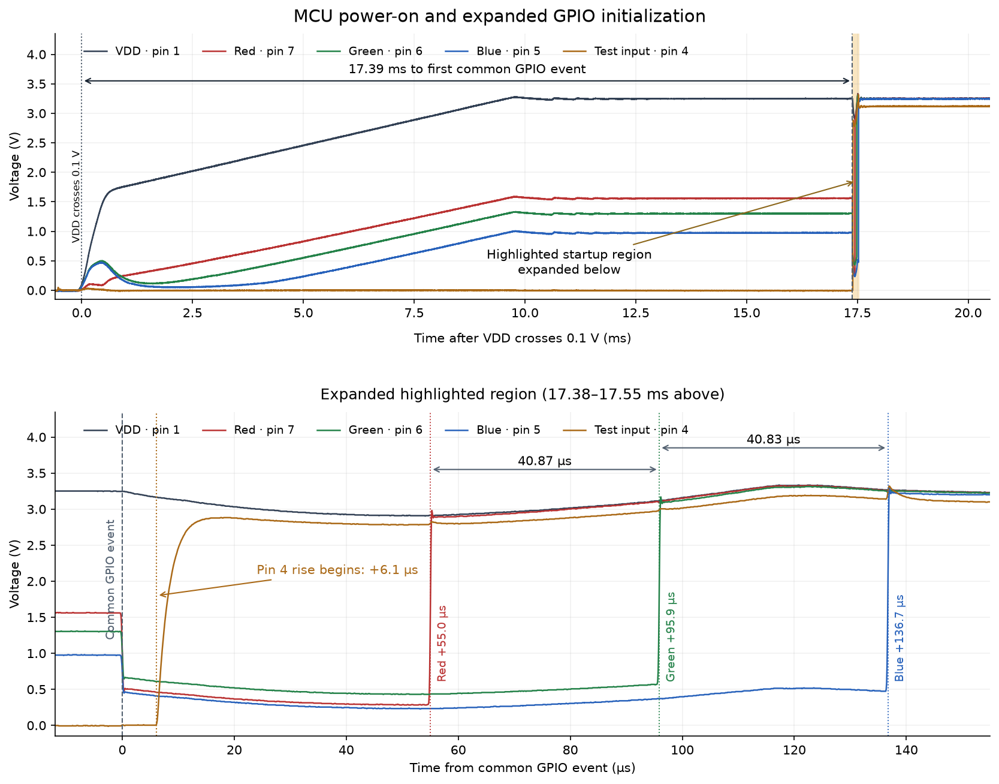

# Identifying the CrowdSync MCU

The wristband's eight-pin MCU has no readable part number. We identified it by tracing its connections, measuring startup behavior and testing the Nyquest programming interface with a read-only Arduino dumper. The evidence strongly supports an **NY8A054E-family MCU**, with **NY8A054ES8** as the matching SOP-8 part. The exact package marking could not be checked.

## Pinout & Candidate Selection

We started with low-cost eight-pin MCUs, including PIC, Padauk and Nyquest candidates. The useful constraints were the supply pins, two inputs, receiver-power control and three LED outputs. The [NY8A054E datasheet, pin assignment and description, pp. 13–14](https://www.nyquest.com.tw/upload/2024_11_293/NY8A054E_v1.5.pdf#page=13) matched the observed wiring:

| Physical pin | Observed board connection | NY8A054ES8 function |
|---:|---|---|
| 1 | Approximately 3.3 V supply | VDD |
| 2 | Enables power to the CMT2210LH receiver | PA7 |
| 3 | Receiver's demodulated data output | PA6 |
| 4 | Test contact; grounding and releasing it selects local effects | PA5 / RSTb / Vpp |
| 5 | Blue LED output, active LOW | PA4 / SCK |
| 6 | Green LED output, active LOW | PA3 / SDO |
| 7 | Red LED output, active LOW | PA2 / SDI |
| 8 | Ground | VSS |

The shared LED/programming pins made the Nyquest hypothesis testable with the existing NY8 dumper. Package size and pinout were useful screening criteria, but were not enough to identify the MCU on their own.

## Power-On Timing

The original Saleae capture recorded the MCU pins as **analog voltages at 12.5 MS/s**, giving 80 ns between samples.



*Both panels show VDD (pin 1), RGB outputs (pins 5–7) and the test input (pin 4). The highlighted region near 17.5 ms is expanded below. The common GPIO event is the simultaneous RGB LOW transition; pin 4 begins rising about 6.1 µs later, followed by the sequential RGB HIGH transitions. The expanded panel uses the common GPIO event as time zero; the HIGH transitions are measured at their midpoints.*

The supply rises gradually, so “power-on” needs a defined voltage reference. Using its first upward crossing of **0.1 V**:

```text
VDD crosses 0.1 V:       2.233426 s
Common GPIO event:      2.250816 s
Delay:                  2.250816 − 2.233426 ≈ 17.39 ms
```

Other reference voltages give different delays to the same event:

| VDD reference | Delay to common GPIO event |
|---|---:|
| 0.1 V | 17.39 ms |
| 1.8 V | 16.20 ms |
| 2.0 V | 15.02 ms |
| 3.2 V | 8.08 ms |

We compared this with the Nyquest reset sequence. The datasheet lists selectable power-up delays of **140 µs, 4.5 ms, 18 ms, 72 ms and 288 ms**, followed by oscillator startup. The measured delay is compatible in scale with the **18 ms** option. It supported the candidate, but did not prove that setting: the internal reset-release point is not visible, and some instructions can execute before a pin changes. Other MCU families can also have configurable startup delays. [NY8A054E reset process, p. 77](https://www.nyquest.com.tw/upload/2024_11_293/NY8A054E_v1.5.pdf#page=77)

## What the GPIO Startup Sequence Shows

| Event | Time after common GPIO event |
|---|---:|
| RGB pins fall together | 0 µs |
| Pin 4 begins rising | Approximately 6.1 µs |
| Red output rises HIGH | Approximately 55.0 µs |
| Green output rises HIGH | Approximately 95.9 µs |
| Blue output rises HIGH | Approximately 136.7 µs |

### Common LOW transition, then separate HIGH transitions

Before initialization, the LED pins sit at different intermediate voltages: approximately **1.56 V red, 1.30 V green and 0.97 V blue**. These are consistent with high-impedance MCU pins biased by the attached LED circuit and measurement inputs, rather than actively driven output levels.

All three then drop together toward **0 V / logic LOW**. The loaded pins retain a few hundred millivolts rather than reaching exactly zero. Because the LEDs are active LOW, this briefly sinks current through all three colors. VDD dips to approximately **2.91 V**, then recovers as red, green and blue are switched HIGH toward the 3.3 V rail.

The common-register explanation was a useful hypothesis, and the firmware later clarified it:

* The three LED pins belong to **Port A**. A shared **IOSTA direction-register write** initially enables their output drivers together. This explains the simultaneous LOW event; it does not require three separate writes of a LOW value.
* The later HIGH transitions are produced by the **timer-driven software PWM routine**, which services red, green and blue in turn. They are not three later direction-register writes. The measured red-to-green and green-to-blue intervals are **40.87 µs** and **40.83 µs**.

The MCU has PWM-capable pins, but this firmware generates its LED timing in software. The startup sequence therefore became a useful check against the recovered program.

### Why pin 4 rises later

Pin 4 also belongs to Port A, but its normal role is an input with a pull-up. Its rise begins about **6.1 µs after** the RGB outputs fall.

The firmware enables PA5's pull-up through the separate **PCON** control, then returns PA5 to input mode through IOSTA. Its delayed rise matches this additional pull-up/input setup sequence. It does not imply a different GPIO port, and the analog onset alone cannot pinpoint the pull-up-register write. The separate direction and PA5 pull-up controls are documented on [pp. 22 and 29](https://www.nyquest.com.tw/upload/2024_11_293/NY8A054E_v1.5.pdf#page=22).

## Testing the Hypothesis Without Programming the MCU

We adapted the [Arduino NY8 dumper](CrowdSync_Arduino_NY8_Dumper/README.md) to attempt a read-only transfer. The wristband remained powered through its normal supply. The Arduino monitored the MCU rail and sent the programming handshake shortly after power-on, before normal application startup.

The connection used the predicted **SCK, SDO and SDI pins on physical pins 5, 6 and 7**, with suitable input protection and voltage dividers. Pin 4 was left disconnected. The procedure applied no programming voltage and issued no erase, program or configuration-write commands.

The read succeeded and returned **2048 14-bit words**. Confidence came from the contents as well as the transfer: the words formed coherent NY8 code, with sensible startup and interrupt handling. Its GPIO setup matched the observed pinout, and its LED-servicing timing matched the capture. The recovered program also matched the [receiver-power behavior](OPERATION.md#receiver-power) measured on the board.

Together, the matching pinout, successful Nyquest readout and agreement between firmware behavior and measured signals identify the NY8 family much more strongly than the startup delay alone. **NY8A054ES8 remains the best-supported specific part**, rather than a part number read from the unmarked package. The wiring and read procedure are documented in the dumper guide.
