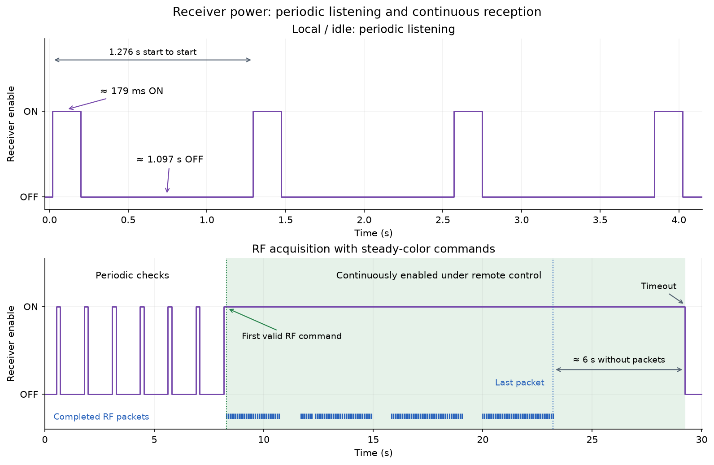
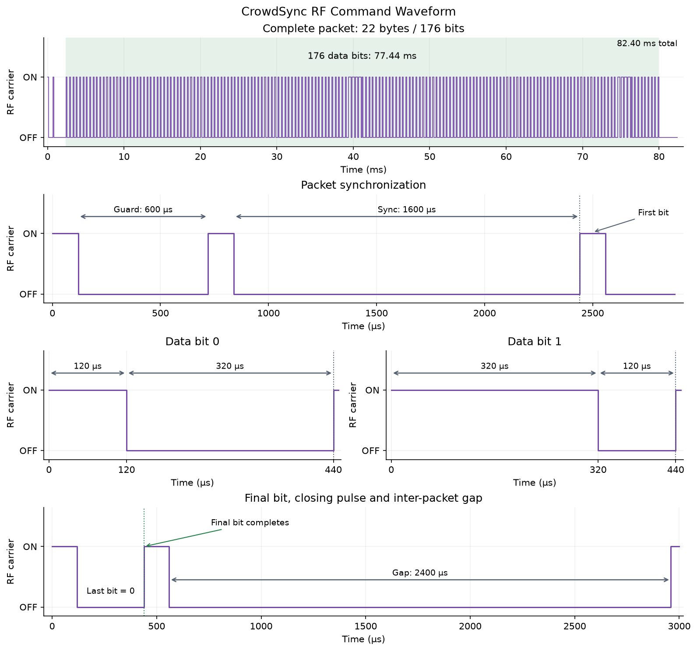

# CrowdSync Wristband Operation & RF Protocol

This document describes how the CrowdSync wristband receives commands, selects colors and effects, and switches between remote control, local demonstrations and power saving. The descriptions apply to the group-6 wristband examined for this project.

## Hardware

The board contains an unmarked eight-pin MCU, a CMT2210LH OOK radio receiver and RGB LEDs. The MCU's pinout and program are consistent with the Nyquest NY8A054E family.

| MCU Pin | Function | Description |
|---:|---|---|
| 1 | Power | Regulated supply, approximately 3.3 V. |
| 2 | Receiver enable | Controls the circuit that supplies power to the RF receiver. HIGH enables the receiver. |
| 3 | Receiver data | Receives the demodulated RF signal from the CMT2210LH. |
| 4 | Test contact | Selects local demonstration modes and also accepts wired command input. |
| 5 | Blue LED | Active-LOW LED output. |
| 6 | Green LED | Active-LOW LED output. |
| 7 | Red LED | Active-LOW LED output. |
| 8 | Ground | Common ground. |

The receiver accepts one-way broadcasts. There is no acknowledgement, pairing process or response transmission from the wristband.

## Operating Modes

| Mode | Description |
|---|---|
| Local / idle | The startup mode. The wristband periodically powers the receiver to listen for commands. Pressing the test contact selects a local demonstration. |
| Remote control | Entered when a valid packet is received. The wristband applies its group's RGB values and effect, and continues running that effect while command activity is maintained. |
| Power saving | Selected by effect 15. The LEDs are blanked and the wristband uses a much longer receiver-off interval. |

At power-on, the wristband starts dark in local/idle mode. A valid received command takes priority over the local demonstration.

### Receiver Power

The receiver uses different power schedules depending on the current mode:

| State | Receiver behavior |
|---|---|
| Local / idle | Enabled for approximately **179 ms every 1.276 s**, with about **1.097 s OFF** between listening windows. |
| Remote effects 0–5 and 14 | Normally remains **continuously enabled after RF acquisition**, including between packets. |
| Random effects 6–13 | Switched OFF during event setup and activity, then enabled again when the event finishes. The off period can include waiting for a trigger. |
| Power saving, effect 15 | Approximately **163 ms ON**, followed by **6.62 s OFF**. |

Repeat complete packets for roughly three seconds when initially taking control so they overlap the idle listening windows. Once an ordinary RF command is received, the receiver is already powered and the idle power cycle stops. It stays enabled for subsequent commands, including when effect 0 selects black.

For these ordinary effects, continuous enablement lasts while remote mode is maintained. After roughly **six seconds without a complete packet**, the wristband returns to local/idle operation and resumes periodic checks. Sending updates every 0.25–1 s leaves margin for missed packets. The communication timeout does not explicitly turn the LEDs off.



The upper plot shows the idle listening cycle. The lower plot shows receiver enable staying HIGH between command bursts, then switching OFF after the communication timeout. The blue markers show completed received packets.

Effects 0–5 and 14 retain the existing receiver-power state rather than forcing it ON. A wired command received during an OFF window can therefore leave the receiver OFF. The continuous-enable behavior above describes ordinary acquisition through RF. Random effects and power saving use their own schedules, so commands sent during their OFF periods cannot be received.

## RF Command Format

Every packet contains **22 bytes**. The first twenty bytes contain ten group assignments, with two bytes for each group. The final two bytes contain a checksum and a zero trailer.

| Byte Positions | Contents |
|---|---|
| 0-19 | Ten group assignments in order, two bytes per group. Group *n* uses bytes `2 × (n − 1)` and `2 × (n − 1) + 1`. |
| 20 | Bitwise XOR of all twenty group-data bytes. |
| 21 | Zero trailer. |

The examined wristband always uses bytes 10 and 11, matching the **6** printed on its housing. The remaining group assignments do not change its displayed effect, but their bytes still participate in the checksum. The group selection is fixed by the firmware and cannot be changed with a normal command.

### Group Assignment Fields

Each two-byte group assignment contains four 4-bit values:

```text
                 7   6   5   4     3   2   1   0
               +-----------------+-----------------+
First byte     |     effect      |       red       |
               +-----------------+-----------------+
Second byte    |      green      |       blue      |
               +-----------------+-----------------+
```

| Field | Range | Description |
|---|---:|---|
| `effect` | 0-15 | Selects the LED behavior from the effect table below. |
| `red` | 0-15 | Red color level. Zero disables red; 15 selects the maximum setting. |
| `green` | 0-15 | Green color level, using the same range. |
| `blue` | 0-15 | Blue color level, using the same range. |

The bytes are constructed as:

```text
first byte  = effect × 16 + red
second byte = green × 16 + blue
```

For example, effect 4 with white RGB values `(15, 15, 15)` produces the two decimal byte values `79, 255`. Effect 0 with red RGB values `(15, 0, 0)` produces `15, 0`.

A group assignment of `0, 0` commands steady black. It does not mean that the group should ignore the packet. When updating one group, a controller should preserve the desired settings for the other nine groups and recalculate the checksum.

### Checksum & Example Packet

The checksum is calculated across all twenty group-data bytes:

```text
checksum = byte[0] XOR byte[1] XOR ... XOR byte[19]
byte[20] = checksum
byte[21] = 0
```

The following complete packet selects steady red for group 6 and black for the other groups. All byte values are decimal:

```text
0 0  0 0  0 0  0 0  0 0  15 0  0 0  0 0  0 0  0 0  15 0
```

A packet is applied only when the checksum matches and the trailer is zero. The checksum is an XOR, not a CRC; changes in different bytes can cancel each other. There is no additional device address, authentication field or replay counter.

## RF Signal Encoding

The radio signal uses **on-off keying (OOK)**. Each interval either transmits the carrier or leaves it off. The examined wristband receives commands transmitted at **433.92 MHz**, verified using a Flipper Zero and a logic analyzer.



A packet begins with synchronization, followed by 176 data bits. Bytes are transmitted in increasing order, with the **most significant bit first** within each byte.

Each bit consists of two intervals between signal edges:

| Bit | First Interval | Second Interval |
|---:|---|---|
| 0 | Short | Long |
| 1 | Long | Short |

The decoder compares the two intervals. If the second is shorter than the first, the bit is 1; otherwise it is 0. The encoding does not depend on an exact short-to-long ratio.

The following nominal timings were used for both wired and RF command tests:

| Stage | Carrier State | Duration |
|---|---|---:|
| Guard pulse | ON | 120 µs |
| Resynchronization guard | OFF | 600 µs |
| Leading pulse | ON | 120 µs |
| Sync interval | OFF | 1600 µs |
| Bit 0 | ON, then OFF | 120 µs, then 320 µs |
| Bit 1 | ON, then OFF | 320 µs, then 120 µs |
| Closing pulse | ON | 120 µs |
| Inter-packet gap | OFF | 2400 µs |

The edge into the closing pulse ends the second interval of the final bit. Without that edge, the receiver is still waiting for the last bit to finish.

The additional 600 µs guard helps the decoder abandon any partial packet before the real sync interval. It is longer than an accepted data interval but shorter than an accepted sync interval. It was added after isolated packets following a long idle gap were occasionally missed.

The decoder measures intervals in increments near 40 µs. Sync accepts 25-50 increments, approximately 1-2 ms, and each data interval accepts 1-12 increments, approximately 40-480 µs. These limits are quantized, so pulse widths near a boundary can be accepted or rejected depending on their timing relative to the measurement step. The defaults leave margin inside those limits.

For isolated RF commands after silence, an optional preamble of 32 repetitions of **120 µs ON, 320 µs OFF** can be added before the guard pulse. This adds 14.08 ms. In a bench comparison after 750 ms silences, 11 of 12 commands worked with the standard guard alone and 12 of 12 worked with this preamble. Repeat important commands; the preamble does not guarantee reception.

The interval limits above describe the decoder. They do not establish the radio's pulse-width tolerance. RF tests worked at 120/320 µs and 240/400 µs short/long timings, while 60/240 µs failed on this setup. Use the nominal timings for transmission.

At these nominal settings, one bit lasts 440 µs and the complete packet, guard and gap take **82.40 ms**. A software sender may take longer; the Arduino controller produces a packet approximately every 89 ms at its default continuous setting. A Flipper Zero can transmit the same waveform over the air.

## LED Effects

The `effect` field selects one of the sixteen behaviors below. Effects 1-5 use the same blinking behavior with different on/off times. Effects 6-13 start their flash, fade or delay at randomly timed intervals.

The effect times are approximate. Receive activity and execution timing can stretch them slightly, and the initial light state may be inherited from the previous effect.

| Effect | Name | Behavior |
|---:|---|---|
| 0 | Steady color | Turns the selected RGB color on continuously at the full shared brightness setting. Setting all three color values to zero turns the LEDs off. |
| 1 | Blink (6 Hz) | Alternates between the selected color and off, with approximately 83 ms in each state. One complete on/off cycle takes about 166 ms, or 6 cycles per second. |
| 2 | Blink (10 Hz) | Same behavior as effect 1, with approximately 50 ms on and 50 ms off: about 10 complete cycles per second. |
| 3 | Blink (14 Hz) | Same behavior as effect 1, with approximately 36 ms on and 36 ms off: about 14 complete cycles per second. |
| 4 | Blink (20 Hz) | Same behavior as effect 1, with approximately 25 ms on and 25 ms off: about 20 complete cycles per second. |
| 5 | Blink (25 Hz) | Same behavior as effect 1, with approximately 20 ms on and 20 ms off: about 25 complete cycles per second. |
| 6 | Random flash (5 ms checks) | When a random trigger occurs, displays the selected color for approximately 100 ms and then turns it off. It remains off until another flash starts. Trigger checks occur approximately every 5 ms. |
| 7 | Random flash (2 ms checks) | Produces the same 100 ms flashes as effect 6, but checks for a trigger approximately every 2 ms. This changes the flash distribution without changing the length of each flash. |
| 8 | Random fade out (9 ms checks) | When triggered, starts the selected color at full brightness and gradually reduces its brightness over approximately 1.27-1.29 s, then turns it off. A later trigger starts another fade from full brightness. Trigger checks occur approximately every 9 ms. |
| 9 | Random fade out (5 ms checks) | Produces the same fade-out sequence as effect 8, with trigger checks approximately every 5 ms instead of 9 ms. |
| 10 | Random fade in (9 ms checks) | When triggered, starts with the LEDs off and gradually increases the selected color to full brightness over approximately 1.33-1.35 s. The color remains on after the fade finishes; another trigger starts a new fade from dark. Trigger checks occur approximately every 9 ms. |
| 11 | Random fade in (5 ms checks) | Produces the same fade-in sequence as effect 10, with trigger checks approximately every 5 ms instead of 9 ms. |
| 12 | Random off/on (9 ms checks) | When triggered, turns the LEDs off for approximately 100 ms and then turns the selected color on. The color remains on until another event changes it. Trigger checks occur approximately every 9 ms. |
| 13 | Random off/on (2 ms checks) | Produces the same off/on sequence as effect 12, with trigger checks approximately every 2 ms instead of 9 ms. |
| 14 | Hold current state | Updates the RGB color while keeping the previous on/off state and shared brightness setting. It stops adding blink or fade progression, so a previously dark state can remain dark. |
| 15 | Power saving | Blanks the LEDs and switches to a longer receiver power cycle: approximately 163 ms listening followed by 6.62 s with the receiver off. See the recovery behavior below. |

### Random Timing & Repeated Commands

“Random” describes the timing of the events, not a random choice of color. The RGB values still come from the command. The trigger depends on a running timing value that is affected by receive activity, so there is no user-selectable probability or fixed average flash rate. Checking for a trigger does not mean that an event will start on every check.

An event already in progress prevents another event from starting. Repeating the same command refreshes its RGB values and keeps remote control active, but does **not** restart a fade each time a packet arrives. Changing the packet rate can still change when the next event starts.

The wristband turns the receiver off while initializing and running these events, then enables it again when the event finishes. The off interval may also include time spent waiting for a trigger. RF packets sent during that interval cannot be received.

Changing the effect does not reset every animation counter or light state. For example, a newly selected effect can briefly retain the previous color's brightness or on/off phase, and a running event may carry into the next selection. Effect 0 is useful when a controller needs to establish a known, continuously lit state before selecting another effect.

## RGB Color & Brightness

Each color channel has sixteen settings, giving **4096 possible RGB combinations**. For a single active primary color, the electrical on-time is approximately the selected value divided by 15. For example, red level 5 gives roughly one third of the on-time of red level 15.

When more than one primary is active, the wristband shares time between them. Full white alternates among red, green and blue, with each primary active for roughly one third of the time. Two active primaries can share time unequally: full red/green measured about 34% red and 65% green, while full red/blue measured about 68% red and 32% blue. RGB values should not be interpreted as independent brightness percentages.

The lower-brightness pattern repeats near 70 Hz. At full white, switching between primaries was measured at about 8.33 kHz per primary. A fade applies an additional shared brightness adjustment to the selected RGB color. These settings describe LED drive timing rather than calibrated optical brightness.

## Command Activity & Timeout

Remote control remains active while complete packets continue to arrive. After approximately **six seconds without a complete packet**, the wristband returns to local/idle operation. This does not explicitly turn the LEDs off: a steady color may remain displayed, or a blinking/fading effect may stop at its last state.

A complete 22-byte packet refreshes this activity timer even when its checksum or trailer is invalid. Such a packet keeps the old effect active but does not apply its proposed RGB/effect values. An incomplete packet does not refresh the timer.

A transmitter should allow margin for missed packets and receiver-off intervals. Repeating during the initial acquisition period and then sending at intervals of 0.25-1 s when reception is available is a practical starting point. The controller's default mode repeats continuously. RF intervals through 5.9 s maintained a blink in the tested sequence, while nominal 6 s intervals already caused brief freezes. Longer intervals can also miss the idle listening windows after timeout.

Stopping the transmitter is different from commanding black. To turn the LEDs off, send effect 0 with RGB `(0, 0, 0)` and allow that command to be received before stopping transmission.

### Synchronizing Commands to Music

The approximately 179 ms listening window applies to local/idle acquisition. Bracelets that are still in that mode can receive the first repeated command at different times, depending on where they are in their listening cycles.

A controller can prepare them before a synchronized sequence:

1. Repeatedly send effect 0 with RGB `(0, 0, 0)` to acquire the bracelets while keeping them dark.
2. Continue sending complete packets before the roughly six-second timeout. After ordinary RF acquisition, effect 0 leaves the receiver enabled, so later commands can be received without waiting for another idle listening window.
3. Send each color change early enough that its complete packet arrives at the intended beat. One packet carries all ten group assignments, allowing the groups to change together.

With the nominal timings above, packet reception completes approximately 79.88 ms after transmission starts. In RF tests, the LED output changed another 0.20-0.29 ms after the final received data edge. Schedule a cue about 80 ms early, or about 94 ms early when adding the optional preamble. Ten prepared 100 ms flashes at 500 ms intervals were reproduced by the tested wristband; timing across multiple wristbands has not been measured.

For beat-driven on/off changes, effect 0 color and black commands provide direct control. Blink commands do not reset each bracelet's blink counter, and the random effects intentionally vary their start times and switch the receiver off during events. There is no timestamp or future-execution field in the packet. With the proposed waveform, complete packets can be sent about twelve times per second; faster blinking is generated locally by effects 1-5.

## Local Demonstration Modes

Pin 4 is connected to the PCB test contact and normally sits HIGH through a pull-up. In local mode, grounding and releasing it advances through the following demonstrations. A mode change occurs on release.

| Position | Mode | Behavior |
|---:|---|---|
| 1 | Red | Displays a steady red color. |
| 2 | Green | Displays a steady green color. |
| 3 | Blue | Displays a steady blue color. |
| 4 | Warm red/green | Displays red mixed with a lower green setting. |
| 5 | Red/blue | Displays blue mixed with a lower red setting. |
| 6 | Green/blue | Displays green mixed with a lower blue setting. |
| 7 | White | Displays all three primaries. |
| 8 | RGB cycle | Displays red, green and blue in sequence, approximately 500 ms per color. |
| 9 | Color crossfade | Moves through six color-wheel segments, changing one level approximately every 10 ms. A settled complete cycle takes about 7.2 s. |
| 10 | Triple-flash RGB | Flashes red three times, then green three times, then blue three times. Each on/off stage is about 150 ms; a full sequence takes about 2.7 s. |
| 11 | Off | Turns the LEDs off. The next short press returns to position 1. |

The static local palettes use slightly lower brightness than the maximum radio-command settings. Startup has a separate dark position before the first red demonstration.

A short press is approximately 11 ms to under 1.5 s; 50-200 ms is a convenient manual press. Longer holds have no assigned action and do not automatically cycle the demonstrations. Local presses are ignored while remote control is active, so stop sending and wait for the communication timeout before using the test contact.

The same contact also accepts encoded command edges. The [Arduino controller guide](CrowdSync_Arduino_Wired_Controller/README.md) describes that wired interface.

## Power Saving & Persistent Settings

Effect 15 reduces receiver-enable duty to approximately 2.4%, compared with about 14% in the normal idle listening cycle. It also disables command decoding during the long receiver-off phase. A new command would need to be received during an enabled listening window to leave this mode.

RF commands can exit effect 15 without a power cycle. After 22 seconds of silence, a repeated blue command restored reception and the blue LEDs about 3.7 seconds into a 24.72-second burst. Repeat the desired command across several long listening cycles; a short burst may miss the receiver-on window. Wired attempts to exit this mode did not succeed in the tested setup. Use effect 0 with zero RGB when the goal is simply to turn the lights off.

Current color, selected effect, local demonstration position and animation phase are volatile. Removing power returns the wristband to its dark startup state. The factory group and program remain, and there is no normal command for changing the factory group, saving an effect across power loss or updating firmware.
