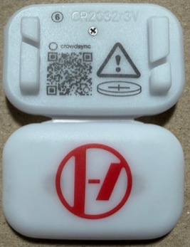
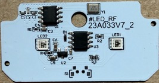

# CrowdSync RF Protocol

This project documents the operation and RF protocol of a CrowdSync wristband, along with tools for extracting its firmware and controlling it from an Arduino or Flipper Zero. The device supports RGB color selection, blinking at several speeds, randomly timed flashes and fades, and a set of local demonstration effects.

## Flipper Zero Controller

The [standalone Flipper Zero app](CrowdSync_Flipper_RF_App/README.md) transmits through the built-in radio, with no USB tether or GPIO wiring. It includes simple control of all groups, individual group assignments, hold-to-light operation, timed bursts, beat pulses and saved settings. A ready-to-install `.fap` and the C source are included.

## RF Protocol

The packet format, RF waveforms, effect descriptions, timing and power-saving behavior are documented in [OPERATION.md](OPERATION.md).

## Arduino Wristband Controller

The [Arduino controller](CrowdSync_Arduino_Wired_Controller/README.md) sends commands through the wristband's test contact, without an RF transmitter. It supports continuous and single-packet transmission, adjustable repeat intervals, raw packets, and local-button tests.

The controller only pulls the contact LOW or releases it to HI-Z. Its wiring guide describes the direct connection and an optional receiver-enable monitor to avoid interference from the RF receiver.

## Reverse Engineering & Firmware Extraction

The wristband uses an unmarked MCU with a pinout and instruction set consistent with the Nyquest NY8A054E family. See [MCU identification](MCU_IDENTIFICATION.md) for the pinout comparison, analog startup measurements and read-only test that led to this conclusion. The [NY8 dumper](CrowdSync_Arduino_NY8_Dumper/README.md) reads program memory using an Arduino while the wristband is powered through its normal board supply.

## Device Support

The wristband examined for this project has **6** printed on its housing and responds to the sixth group assignment in each packet. Other factory group variants have not been examined. The packet format and all sixteen effect selections have been exercised through the wired input and over the air using a Flipper Zero at **433.92 MHz**. RF tests also covered primary brightness levels, group selection, command timing and recovery from power saving.

*Front and rear of the tested wristband. The circled 6 is printed on the rear of the housing.*

*Component side of the PCB, marked `#LED_RF 23A033V7_2`, showing the two RGB LEDs and two eight-pin ICs.*
